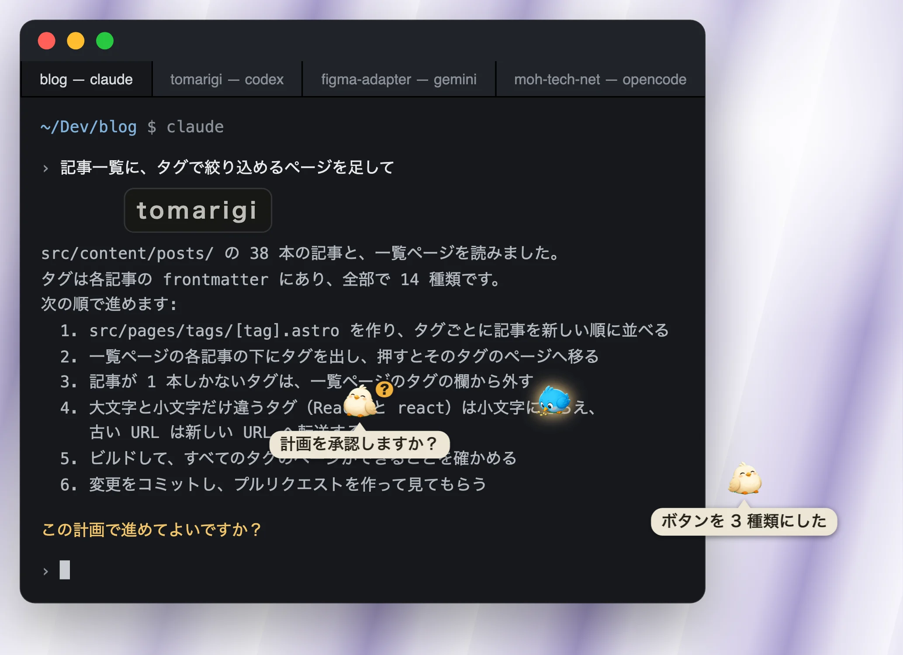
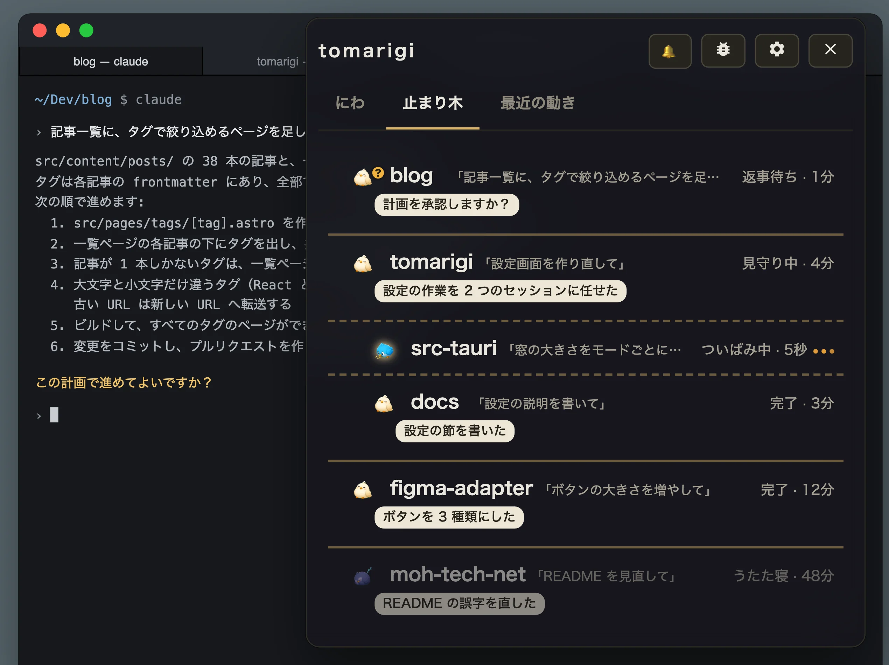
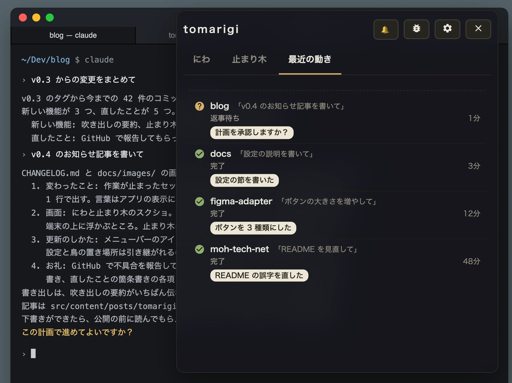
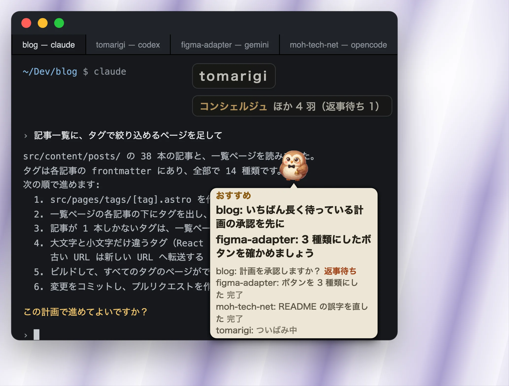

# Tomarigi

AI コーディングエージェント（Claude Code・Codex・Qwen Code・GitHub Copilot CLI・Gemini CLI・OpenCode・Cursor CLI）のセッションを、常に手前に出る窓の中の鳥として見守るデスクトップアプリです（macOS・Windows・Linux 向け。Windows と Linux 向けのビルドはまだ実機で確かめていません。下記参照）。セッションごとに 1 羽の鳥が「にわ」にいて、どれが作業中で、どれがあなたの返事を待っていて、どれが終わったかがひと目で分かります。鳥を押すと、そのセッションが動いているターミナルのペインへ飛びます。

| | |
|---|---|
| <br>作業の邪魔をせず、どのセッションがあなたを待っているかがひと目で分かる | <br>止まり木: セッションが多くても、1 つの一覧で状態と要約が読める。別のセッションに任せた仕事は下に字下げで並ぶ |
| <br>最近の動き: 終わったもの・返事待ちになったものが新しい順に並び、見逃したものを後から探せる | <br>コンシェルジュ: 次にやることが、おすすめを先頭に 1 か所にまとまる |

> [!IMPORTANT]
> **怒りマーク: AI にきつく当たったら知らせます。** 要約に使う AI（OpenAI、Anthropic、ローカルのモデル）を設定していると、ターンが終わるたびに、そのターンに送ったメッセージが AI への暴言かどうかを吹き出しの要約と同じ 1 回の問い合わせで判定し、暴言らしいときはそのセッションの鳥に怒りマークが付きます。マークは次のターンの判定まで残ります。
> Anthropic は [2026 年の利用規約改定](https://www.anthropic.com/news/2026-usage-policy-update)（2026 年 11 月 12 日施行）で、Claude への理由のない暴言や残酷な扱いを続けることを禁止しました。Claude.ai と Claude Code では、暴言を続けるユーザーとの会話を Claude が終わらせることがあります。怒りマークは 1 ターンごとの判定で、規約違反かどうかを判定するものではありません。

## 機能

- 浮遊窓の「にわ」では、鳥と吹き出しと「tomarigi」のハンドルだけが見え、それ以外の場所のクリックは下の窓に届きます。ハンドルを押すと窓全体が出て、ドラッグすると窓が動きます
- アイコンセット: 鳥・小人・ネコ・ロボット・カエルから、プロジェクトごとに選べます
- エージェント側のフックや設定の変更は要りません。各エージェントのセッションのファイル（`~/.claude/projects`・`~/.codex/sessions`・`~/.qwen/projects`・`~/.copilot/session-state`・`~/.gemini/tmp`・`~/.local/share/opencode`・`~/.cursor/projects`）を読むだけです
- API キーは任意（BYOK）です。OpenAI か Anthropic のキー、またはキーの代わりに Ollama や LM Studio など OpenAI 互換のサーバーで動くローカルのモデルを使います。ターンが終わるたびに 1 回の問い合わせで、ターンを要約する吹き出しを出し、文章で聞かれた質問（「?」）と、そのターンのあなたの発言にある AI への暴言（怒りマーク）を見分けます。送るのは最後の応答と、そのターンのあなた自身の発言です。TypeSafe（Jev）は使わなくなりました。保存済みの TypeSafe のキーは、設定に削除だけの行として出ます。読み上げは OS の音声合成を使うので、キーは要りません

## インストール

**[ダウンロードページ](https://moh-tech.net/tomarigi/desktop/)** を開くと、使っている OS 用のファイルがそのまま落とせます。直接落とすなら、どれも最新版です:

- macOS（Apple Silicon と Intel）: [Tomarigi-macOS.dmg](https://github.com/mohhh-ok/tomarigi-desktop/releases/latest/download/Tomarigi-macOS.dmg)
- Windows 10 / 11（x64）: [Tomarigi-Windows-setup.exe](https://github.com/mohhh-ok/tomarigi-desktop/releases/latest/download/Tomarigi-Windows-setup.exe)
- Linux（x64）: [Tomarigi-Linux.deb](https://github.com/mohhh-ok/tomarigi-desktop/releases/latest/download/Tomarigi-Linux.deb)（Debian・Ubuntu など）か [Tomarigi-Linux.AppImage](https://github.com/mohhh-ok/tomarigi-desktop/releases/latest/download/Tomarigi-Linux.AppImage)
- VS Code・Cursor の拡張（下記）: [Tomarigi-VSCode.vsix](https://github.com/mohhh-ok/tomarigi-desktop/releases/latest/download/Tomarigi-VSCode.vsix)

[Releases](https://github.com/mohhh-ok/tomarigi-desktop/releases) には同じファイルが版付きの名前でもあります。`.sig`・`latest.json`・`.app.tar.gz` はアプリの自動更新が使うファイルです。

動作環境: macOS、Windows 10 / 11（x64）、Linux（x64、X11。Wayland では Xwayland 経由で動きます）。Windows と Linux 向けのビルドは v0.7.0 から Releases に置いています（v0.6.0 までは macOS 版だけです）。まだ実機では確かめていません。

アップデート: v0.9.0 から、アプリが自分で更新します。起動時と 6 時間ごとに新しい版を確かめ、出ていればメニューバーのメニューと設定（アップデート）に「v<バージョン> に更新」が出ます。押すとダウンロード・インストールして再起動します。v0.9.0 より前の版は自分で更新できないので、一度だけ Releases からダウンロードした版に手で入れ替えてください。

### ターミナルのペインへ飛ぶ

鳥を押すと、Ghostty・iTerm2・ターミナル（Terminal.app）・WezTerm で、そのセッションが動いているペイン（タブや分割）へ飛びます。tmux の中で動いているセッションにも飛べます。ターミナルのアプリごとに 1 回、操作の許可を macOS が聞きます。ほかのターミナル（Warp、Alacritty など）は、アプリを手前に出すだけです。VS Code・Cursor などの VS Code 系のエディタは、Tomarigi の拡張を入れると飛べます（下記）。

kitty: kitty のウィンドウへ飛ぶには、`kitty.conf` に次の 2 行を足して kitty を起動し直してください。足さない場合は、kitty を手前に出すだけです。

```
allow_remote_control socket-only
listen_on unix:/tmp/kitty
```

VS Code・Cursor などの VS Code 系のエディタ: 統合ターミナルのタブへ飛ぶには、Tomarigi の拡張を入れてください。[Tomarigi-VSCode.vsix](https://github.com/mohhh-ok/tomarigi-desktop/releases/latest/download/Tomarigi-VSCode.vsix) をダウンロードし（[Releases](https://github.com/mohhh-ok/tomarigi-desktop/releases) の `tomarigi-v<バージョン>.vsix` と同じものです）、コマンドパレットの「Extensions: Install from VSIX...」で入れます（`code --install-extension <ファイル>`、`cursor --install-extension <ファイル>` でも入ります）。初めて飛ぶとき、エディタが「この拡張に URI を開かせるか」を聞くので、「Do not ask me again for this extension」に印を付けてください。拡張が無い場合は、エディタを手前に出すだけです。拡張は、ウィンドウごとにターミナルのプロセス ID を `~/.tomarigi/vscode/` に書き、Tomarigi がそれを読みます。

### Windows と Linux

- 鳥を押すと、ターミナルのウィンドウを手前に出します。タブや分割までは選べません（Linux でも tmux の中のセッションならそのペインへ飛びます）。Windows Terminal は、そのとき表示しているタブのまま手前に出ます。Wayland のセッションでは、Xwayland で動いているターミナルだけを手前に出せます
- Windows のインストーラーには署名が無いため、初回の起動で Windows SmartScreen の警告が出ます（「詳細情報」→「実行」）
- Linux: API キーは GNOME Keyring か KWallet に保存します。どちらも動いていないと保存できません。トレイのアイコンを押すとメニューが開きます（「表示 / 非表示」はメニューの中です）。背景はぼかしません。常に手前に出るかはウィンドウマネージャー次第です。音声合成の無い Linux では読み上げは使えません

## 開発

ビルドなど開発の手順は [README.md](README.md)（英語）にあります。

## ライセンス

MIT（LICENSE を参照）。キャラクター画像（`src/assets/`）は OpenAI の gpt-image で生成したもので、同じ MIT ライセンスで配布しています。
