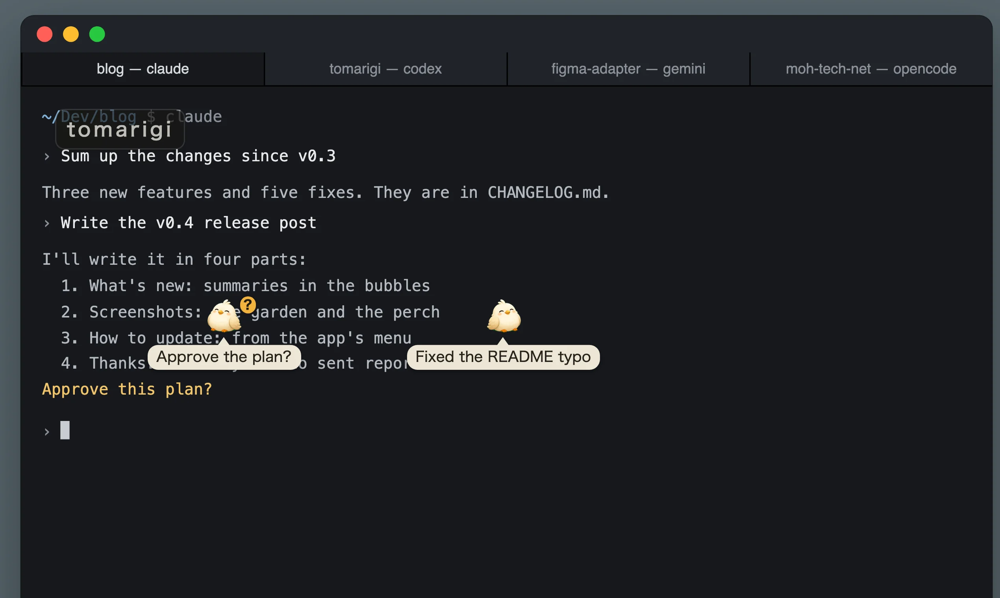
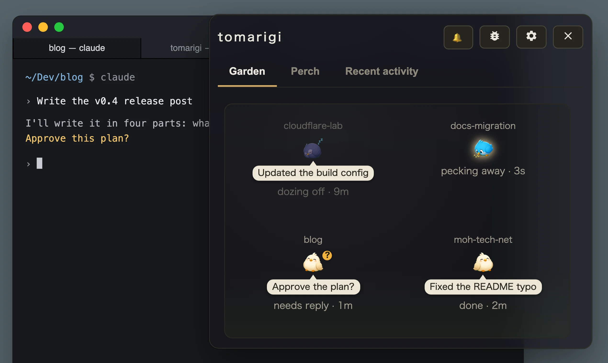
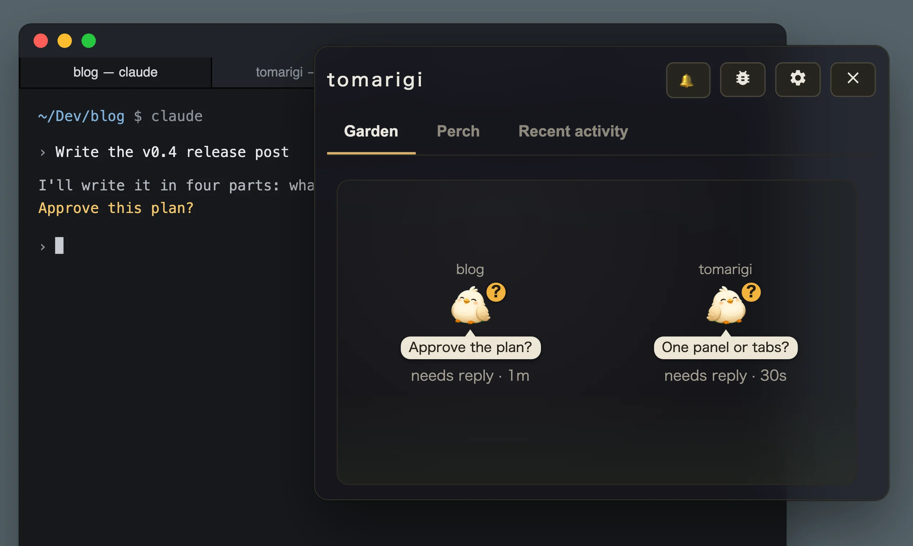
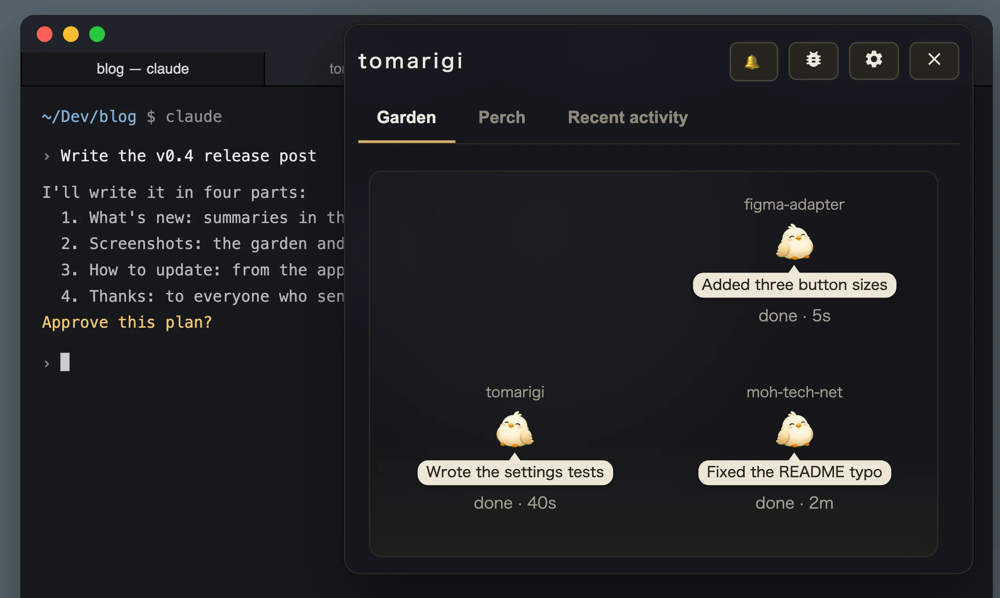

# Tomarigi

[日本語](README.ja.md)

A desktop app for macOS, Windows, and Linux (the Windows and Linux builds haven't been checked on real machines yet; see below) that watches your AI coding agent sessions (Claude Code, Codex, Qwen Code, GitHub Copilot CLI, Gemini CLI, OpenCode, Cursor CLI) as birds in an always-on-top window. Each session gets its own bird in the Garden, so you can tell at a glance which one is working, which one is waiting for your reply, and which one is done. Click a bird to jump to the terminal pane where that session is running.

| | |
|---|---|
| <br>Stays on top of your other windows, and you can see through it | <br>One bird for each agent session |
| <br>A question mark shows up when the agent is waiting on you | <br>When a turn ends, the bubble sums it up |

> [!IMPORTANT]
> **The anger mark: a heads-up when you're harsh to the AI.** With a summary provider set up (OpenAI, Anthropic, or a local model), each time a turn ends, the messages you sent during that turn are checked for abuse toward the AI in the same request that writes the speech bubble, and the session's bird gets an anger mark when one looks abusive. The mark stays until the next turn is checked.
> Anthropic's [2026 Usage Policy update](https://www.anthropic.com/news/2026-usage-policy-update) (effective November 12, 2026) prohibits sustained and needless abusive or cruel behavior toward Claude, and Claude can end conversations with persistently abusive users on Claude.ai and Claude Code. The anger mark judges one turn at a time and is not a judgment of whether you violated that policy.

## Features

- In the floating window's Garden, only the birds, their bubbles, and the "tomarigi" handle are shown, and clicks go through to the window below. Click the handle to show the whole window; drag it to move the window
- Icon sets: Birds, Gnome, Cat, Robot, and Frog, assigned per project
- No hooks or config changes on the agent side. It only reads each agent's session files (`~/.claude/projects`, `~/.codex/sessions`, `~/.qwen/projects`, `~/.copilot/session-state`, `~/.gemini/tmp`, `~/.local/share/opencode`, `~/.cursor/projects`)
- Optional BYOK keys: OpenAI or Anthropic (or, without a key, a local model on an OpenAI-compatible server such as Ollama or LM Studio). One request per finished turn writes the speech bubble that summarizes it, spots a question asked in plain text (the "?"), and spots abuse toward the AI in your messages of that turn (the anger mark); the last reply and your own messages of that turn are sent. TypeSafe (Jev) is no longer used: a TypeSafe key still saved shows in settings with only Delete. Voice readout uses the system speech synthesizer and needs no key

## Install

Open the **[download page](https://moh-tech.net/en/tomarigi/desktop/)** for the file for your OS. Or download the latest version directly:

- macOS (Apple Silicon and Intel): [Tomarigi-macOS.dmg](https://github.com/mohhh-ok/tomarigi-desktop/releases/latest/download/Tomarigi-macOS.dmg)
- Windows 10 / 11 (x64): [Tomarigi-Windows-setup.exe](https://github.com/mohhh-ok/tomarigi-desktop/releases/latest/download/Tomarigi-Windows-setup.exe)
- Linux (x64): [Tomarigi-Linux.deb](https://github.com/mohhh-ok/tomarigi-desktop/releases/latest/download/Tomarigi-Linux.deb) (Debian, Ubuntu, and others) or [Tomarigi-Linux.AppImage](https://github.com/mohhh-ok/tomarigi-desktop/releases/latest/download/Tomarigi-Linux.AppImage)
- The VS Code / Cursor extension (below): [Tomarigi-VSCode.vsix](https://github.com/mohhh-ok/tomarigi-desktop/releases/latest/download/Tomarigi-VSCode.vsix)

[Releases](https://github.com/mohhh-ok/tomarigi-desktop/releases) has the same files under names with the version too. `.sig`, `latest.json`, and `.app.tar.gz` are for the app's updater.

Requirements: macOS, Windows 10 / 11 (x64), or Linux (x64, X11; on Wayland it runs through Xwayland). The Windows and Linux builds are on Releases from v0.7.0 (v0.6.0 and earlier are macOS only) and haven't been checked on real machines yet.

Updates: from v0.9.0 the app updates itself. It checks at launch and every 6 hours; when a new version is out, "Update to v<version>" appears in the menu bar menu and in settings (Updates), and clicking it downloads, installs, and restarts. Versions before v0.9.0 can't update themselves, so replace those once by hand with the download from Releases.

### Jumping to the terminal pane

Clicking a bird jumps to the pane (tab or split) where that session runs in Ghostty, iTerm2, Terminal.app, or WezTerm, also when the session runs inside tmux. macOS asks once per terminal app for permission to control it. Other terminals (Warp, Alacritty, and others) are only brought to the front. VS Code, Cursor, and other VS Code forks need Tomarigi's extension (below).

kitty: to jump to the kitty window, add these two lines to `kitty.conf` and restart kitty. Without them, kitty is only brought to the front.

```
allow_remote_control socket-only
listen_on unix:/tmp/kitty
```

VS Code, Cursor, and other VS Code forks: to jump to the integrated terminal tab, install Tomarigi's extension. Download [Tomarigi-VSCode.vsix](https://github.com/mohhh-ok/tomarigi-desktop/releases/latest/download/Tomarigi-VSCode.vsix) (the same file as `tomarigi-v<version>.vsix` on [Releases](https://github.com/mohhh-ok/tomarigi-desktop/releases)) and install it with "Extensions: Install from VSIX..." in the command palette (or `code --install-extension <file>`, `cursor --install-extension <file>`). The first time you jump, the editor asks whether the extension may open the URI; check "Do not ask me again for this extension". Without the extension, the editor is only brought to the front. Each editor window writes the process ids of its terminals to `~/.tomarigi/vscode/` for Tomarigi to read.

### Windows and Linux

- Jumping brings the terminal window to the front but can't pick its tab or split (on Linux, a session inside tmux still gets its pane). Windows Terminal comes forward on whatever tab it shows. On a Wayland session only terminals running through Xwayland can be brought forward
- The Windows installer isn't code-signed, so Windows SmartScreen warns on first run ("More info" → "Run anyway")
- Linux: API keys are saved to GNOME Keyring or KWallet; without one running, keys can't be saved. The tray icon opens its menu ("Show / Hide" is there), the background isn't blurred, and staying on top depends on the window manager. Some Linux systems have no speech engine, and readout is off there

## Development

The design spec lives in docs/design.md.

### Build

```sh
bun install                   # prepare sets core.hooksPath to .githooks and enables the gitleaks pre-commit hook
bun run dev                   # run the dev app (tauri dev; also starts the vite dev server, bun run dev:web)
bun run build:verify          # verification .app (src-tauri/target/debug/bundle/macos/tomarigi-desktop (verify).app) with a greenish background. Signed with your local Apple Development certificate (scripts/build-verify.sh; override with APPLE_SIGNING_IDENTITY)
bun run tauri build --debug   # src-tauri/target/debug/bundle/macos/tomarigi-desktop.app
bun run tauri build           # release build. Put the resulting .app at /Applications/tomarigi-desktop.app
bun run gen:locales           # scripts/locales/*.mjs → public/_locales/*/messages.json (also runs in bun run build)
bun run verify:locales        # checks that all 43 locales have exactly the same keys
bun run test                  # tests/ (bun test) and the Rust unit tests (cargo test --lib)
```

### Releases

Distribution builds are made by CI when a `v*` tag is pushed (signed, notarized, attached to a draft GitHub Release). See docs/release.md.

### Everyday, dev, and verify builds

The everyday build (/Applications), `bun run dev`, and `bun run build:verify` use different identifiers (`src-tauri/tauri.dev.conf.json` and `tauri.verify.conf.json` are layered with `--config`). Single-instance locking, settings, and window position are separate for each, so they can run side by side. Each one asks for permission to control each terminal app on first use. Agents that launch the app for verification should only launch the verify .app (so they don't stop the everyday build or dev).

### Locales

`public/_locales` is generated. Don't edit it directly; write every locale in scripts/locales/*.mjs and generate.

### Ports

The dev server port is fixed at 4842 in `vite.config.ts` and `src-tauri/tauri.conf.json`. HMR uses port 4843 only when `TAURI_DEV_HOST` is set (running the dev app on another device).

### Environment variables at launch

Pass them when running the binary `Contents/MacOS/tomarigi-desktop` directly.

- `TOMARIGI_MOCK=1`: mock mode. Injects presets / JSON instead of real data. The mock screen also opens in a plain browser at `http://localhost:4842/?mock=1` while the dev server runs (`bun run dev:web`)
- `TOMARIGI_QUERY`: initial screen. Join `tab=perch` / `tab=events` / `settings=1` / `dialog=add-folder` (the add-folder dialog; with `TOMARIGI_MOCK=1` the default folders of every agent are listed) / `debug=1` / `preset=<id>` (initial mock preset; `preset=asking` shows the "?") / `scrollTo=<class name>` (scrolls the window to that element, e.g. `settings=1&scrollTo=window-mode`) / `cycle=<seconds>` (mock: every few seconds changes one thing on the birds in turn, a bubble, a tool line, a watch link, a bird joining or leaving; logged as `[mock-cycle]`) / `panel=0` (mock: hides the mock controls) / `birds=<n>` (mock: adds n plain birds) / `concierge=<text>` (mock: shows the concierge with that advice about the first bird that needs a reply; empty for a default line, `none` for no advice; without it the real concierge is asked only with a saved key) / `tint=0` (verify build: skips the greenish background, so screenshots show the everyday look) / `keystore=unavailable` (settings as on a Linux computer without a key store) / `speech=none` (settings as on a system without a speech engine) / `update=<status>` (settings' Updates section in that status: `checking` / `upToDate` / `checkFailed` / `available` / `downloading` / `installing` / `installFailed`) with `&`
- `TOMARIGI_FOCUS_TEST="<config_dir>|<sessionId>|<return tty>"` (or `"pid=<pid>|<return tty>"` for a process of any agent): 3 seconds after launch, jumps to that session's terminal pane, then 1.5 seconds later jumps back to the return pane (logs `[focus-test] -> Pane ...` with the terminal and how it was found)
- `TOMARIGI_FADE_TEST=1`: "Fade until hovered" self-test. 4 seconds after launch, shows the faded Garden as clicking the window handle would, keeps it shown for 6 seconds as if the cursor were in the window, then lets it fade again (logs `[fade-test] reveal` and `[fade] revealed=...`)
- `TOMARIGI_MODE_TEST`: window mode self-test. `1` cycles standard → floating → standard → maximized → full screen → floating every 5 seconds; `normal` just switches to the standard window
- `TOMARIGI_IMPORT_KEY=<anthropic|openai>`: saves the first line of stdin as that provider's API key (for checking without operating the settings screen by hand; only the length is logged)
- `TOMARIGI_LOCAL_AI="<base URL>|<model>"`: sets up Local AI with that server and model, chooses it for summaries and the concierge, and logs the connection test result (`[keys] imported local ...`)
- `TOMARIGI_KEY_BACKEND=webview`: stores keys in IndexedDB instead of the Keychain (for testing the IndexedDB → Keychain migration)

### Other notes

Where BYOK API keys are stored depends on the identifier (KeyStore in src-tauri/src/keys.rs); see "BYOK API keys" in docs/design.md.

Logs are appended to `~/Library/Logs/tomarigi-desktop/app-log.txt` (`~/.local/state/tomarigi-desktop/app-log.txt` on Linux, `%TEMP%\tomarigi-desktop\app-log.txt` on Windows). Past 10 MB the file becomes `app-log.1.txt` and a new one starts.

The Rust tauri crates are pinned to match `@tauri-apps/api` on the npm side; see the comment in `src-tauri/Cargo.toml`.

## License

MIT (see LICENSE). The character images (`src/assets/`) were generated with OpenAI's gpt-image and are distributed under the same MIT license.
